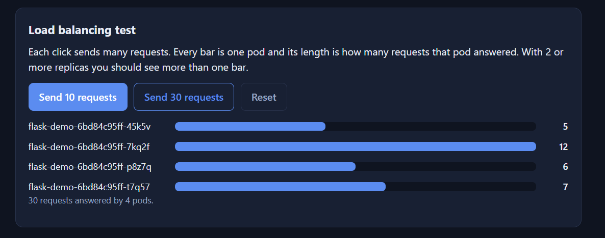
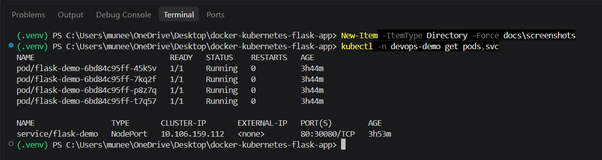

# Docker Containerization and Kubernetes Deployment

A small Flask web app that I containerized with Docker and deployed to a local Kubernetes cluster (minikube). The web page shows which pod answered the request, the app version, the environment and the health status. A button sends many requests so you can see load balancing across pods.

I built this step by step to practise the core container workflow: build an image, run it, then deploy it to Kubernetes with health checks, resource limits, scaling, rolling updates and rollback.



## What this project shows

- A production-style `Dockerfile`: slim base image, cached dependency layer, non-root user, `HEALTHCHECK`, Gunicorn server, and the app version set with a build argument
- Local run with `docker run` and `docker compose`
- Kubernetes manifests: Namespace, ConfigMap, Deployment (2 replicas) and Service (NodePort)
- Liveness and readiness probes on `/health`
- Resource requests and limits, and a restricted `securityContext` (non-root, no privilege escalation, all capabilities dropped)
- Manual scaling
- Zero-downtime rolling update and rollback

## Architecture

```
Browser
   |
   v
Service (NodePort 30080 -> port 80)
   |
   +--> Pod flask-demo-xxxxx (Gunicorn :5000)
   +--> Pod flask-demo-yyyyy (Gunicorn :5000)
        (namespace: devops-demo, APP_ENV from the ConfigMap)
```

## Routes

| Route | Returns | Used for |
| --- | --- | --- |
| `/` | HTML page | The dashboard in the browser |
| `/api/info` | JSON | Pod name, version, environment (called by the page) |
| `/health` | JSON | Docker HEALTHCHECK and Kubernetes probes |

The **version** is set when the image is built (`--build-arg APP_VERSION=...`). The **environment name** comes from the Kubernetes ConfigMap (or `docker-compose.yml`). That is why a rolling update changes the version on the page while the environment stays the same.

## Project structure

```
.
├── app.py                  # Flask app
├── templates/index.html    # The web page
├── static/                 # app.js (page logic) and style.css
├── tests/test_app.py       # Unit tests (pytest)
├── requirements.txt        # Runtime dependencies
├── requirements-dev.txt    # Adds pytest
├── Dockerfile
├── .dockerignore
├── docker-compose.yml
├── k8s/
│   ├── namespace.yaml
│   ├── configmap.yaml
│   ├── deployment.yaml
│   └── service.yaml
└── docs/screenshots/
```

## Prerequisites (Windows)

- Docker Desktop (WSL 2 backend)
- `kubectl` and `minikube`:
  ```powershell
  winget install -e --id Kubernetes.kubectl
  winget install -e --id Kubernetes.minikube
  ```
- Python 3.12+ (only to run the tests locally)

## 1. Run locally

```powershell
python -m venv .venv
.venv\Scripts\Activate.ps1
pip install -r requirements-dev.txt
pytest
python app.py
```

Open http://localhost:5000

## 2. Build and run with Docker

```powershell
docker build --build-arg APP_VERSION=1.1.0 -t flask-devops-demo:1.1.0 .
docker run --rm -d --name flask-demo -p 5000:5000 flask-devops-demo:1.1.0
docker ps
curl.exe http://localhost:5000/api/info
docker stop flask-demo
```

`docker ps` shows `(healthy)` once the `HEALTHCHECK` passes. `docker exec flask-demo id` shows the app runs as `uid=10001(appuser)`, not root.

## 3. Run with Docker Compose

```powershell
docker compose up --build -d
docker compose ps
docker compose down
```

## 4. Deploy to Kubernetes (minikube)

Start a local cluster and load the image into it. The manifests use `imagePullPolicy: IfNotPresent`, so no registry is needed.

```powershell
minikube start --driver=docker
minikube image load flask-devops-demo:1.1.0
```

Deploy:

```powershell
kubectl apply -f k8s/namespace.yaml
kubectl apply -f k8s/
kubectl -n devops-demo get pods,svc
kubectl -n devops-demo rollout status deployment/flask-demo
```



Open the app (keep this terminal open while you use the app, because minikube runs a tunnel on Windows):

```powershell
minikube service flask-demo -n devops-demo
```

## 5. See load balancing

On the web page, click **Send 30 requests**. You should see one bar for each pod.

> `kubectl port-forward` always talks to a single pod, so the page would show only one bar. Use `minikube service` for this test.

## 6. Scale

```powershell
kubectl -n devops-demo scale deployment/flask-demo --replicas=4
kubectl -n devops-demo get pods
```

Click **Reset** and **Send 30 requests** again. You should now see 4 bars.

## 7. Rolling update and rollback

The version is a build argument, so no code change is needed:

```powershell
docker build --build-arg APP_VERSION=1.1.1 -t flask-devops-demo:1.1.1 .
minikube image load flask-devops-demo:1.1.1
kubectl -n devops-demo set image deployment/flask-demo flask-demo=flask-devops-demo:1.1.1
kubectl -n devops-demo rollout status deployment/flask-demo
```

Refresh the page: the **Version** card shows `1.1.1`. With `maxUnavailable: 0`, a new pod must be ready before an old one is stopped, so the app stays available.

Roll back:

```powershell
kubectl -n devops-demo rollout history deployment/flask-demo
kubectl -n devops-demo rollout undo deployment/flask-demo
```

The version is back to `1.1.0`.

## Troubleshooting

Problems I hit while building this, and how I fixed them:

| Problem | Cause and fix |
| --- | --- |
| `minikube` is not recognized in a terminal | The terminal started before the install, so its PATH is old. Open a new terminal or restart VS Code. |
| `minikube start` fails with `INET_DOWNLOAD_BLOCKED` / timeout | Slow or unstable connection to `dl.k8s.io`. Run `minikube start --driver=docker` again (cached files are reused), or try another network. |
| Node stays `NotReady`, `kindnet` pod in `ImagePullBackOff` | The network plugin image was slow to download. Wait, or `docker pull` the image and run `minikube image load` on it. |
| Pod stuck in `ErrImagePull` / `ImagePullBackOff` (app) | The image was not loaded into the cluster. Run `minikube image load ...` again. |
| Pod `CrashLoopBackOff` | `kubectl -n devops-demo logs POD_NAME` and `kubectl -n devops-demo describe pod POD_NAME` |
| Page shows only one pod | You are probably using `port-forward`. Use `minikube service` instead. |
| Version does not change after update | Check that you built with `--build-arg APP_VERSION=...` and loaded the new image. |

## Clean up

```powershell
kubectl delete namespace devops-demo
minikube stop
```

## What I learned

- **Image vs container.** An image is a read-only blueprint of the app. It contains the code, Python and all the dependencies, and it is built from the Dockerfile. A container is a running instance of an image. One image can start many containers, which is what Kubernetes does when it runs 4 pods from the same image.
- **Layer caching.** Each Dockerfile instruction creates a layer, and Docker reuses a layer if nothing it depends on has changed. I copy `requirements.txt` and run `pip install` before copying the app code, so a code change does not reinstall every package and builds stay fast.
- **Deployment, Service and ConfigMap.** A Deployment keeps the desired number of pods running, replaces pods that die, and handles rolling updates and rollbacks. A Service gives the pods one stable address and spreads requests across them, because pod names and IPs change. A ConfigMap keeps settings such as `APP_ENV` outside the image, so the same image can run in different environments.
- **Zero-downtime rolling updates.** With `maxSurge: 1` and `maxUnavailable: 0`, Kubernetes starts one new pod first and only stops an old pod after the new one passes its readiness probe on `/health`. The Service only sends traffic to ready pods, so the app stays available during the update. `kubectl rollout undo` goes back to the previous version.
- **Non-root containers and health checks.** Running as a non-root user limits the damage if the app is compromised. `HEALTHCHECK` and Kubernetes probes let Docker and Kubernetes detect an unhealthy app automatically.
- **Debugging.** A terminal started before an install keeps the old PATH, so `minikube` was not found until I opened a new terminal. `minikube start` timed out on a slow connection and worked when I ran it again, because downloaded files are cached. The node stayed `NotReady` because the `kindnet` network plugin was still pulling its image, and `kubectl get pods -n kube-system` showed the cause.
